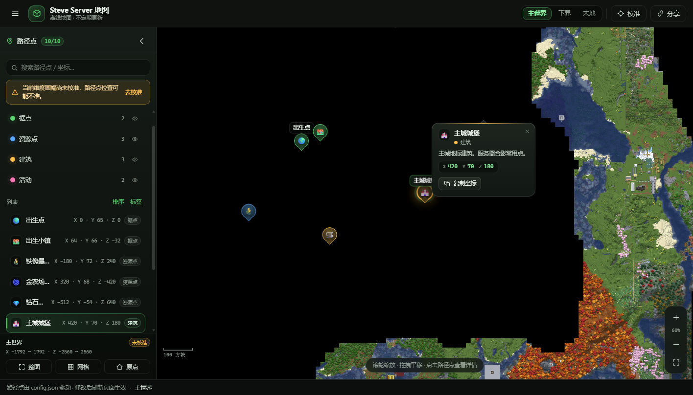
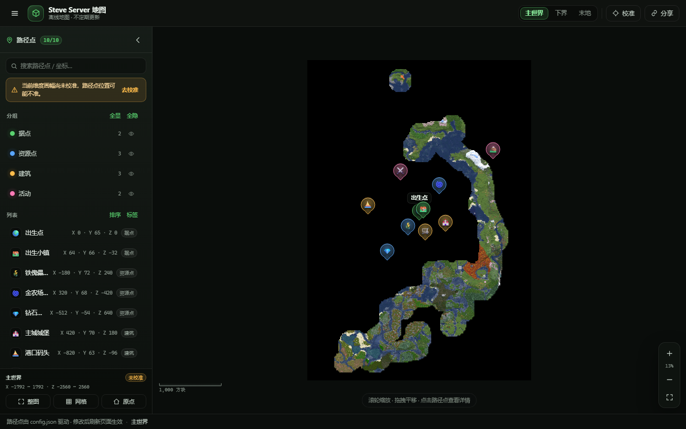
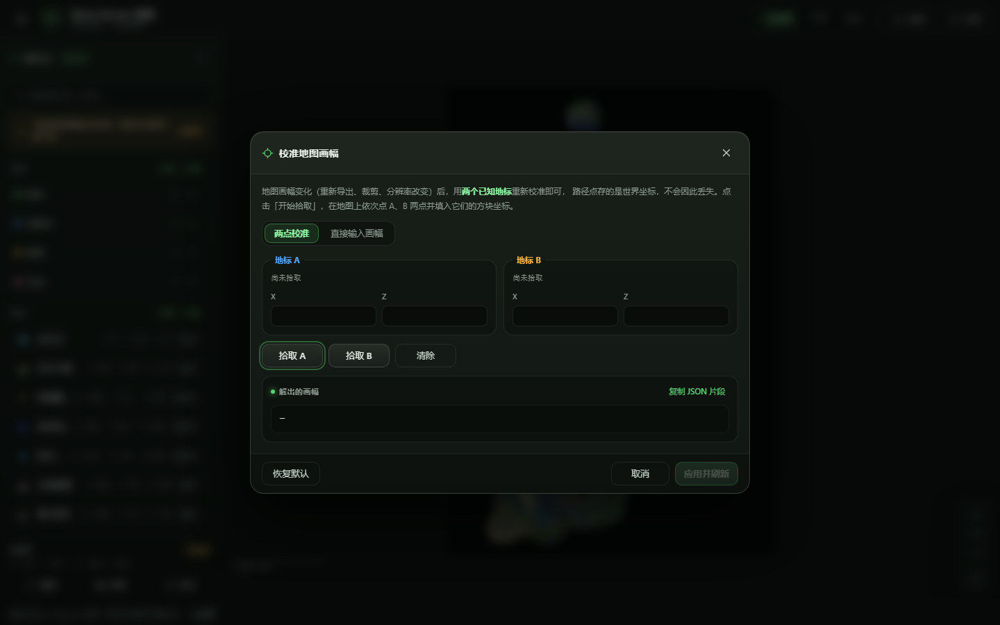
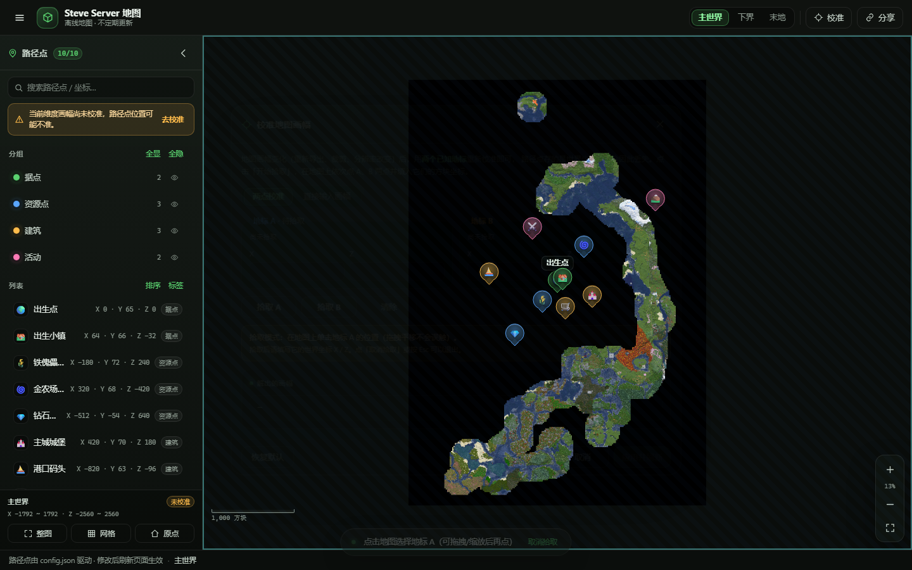
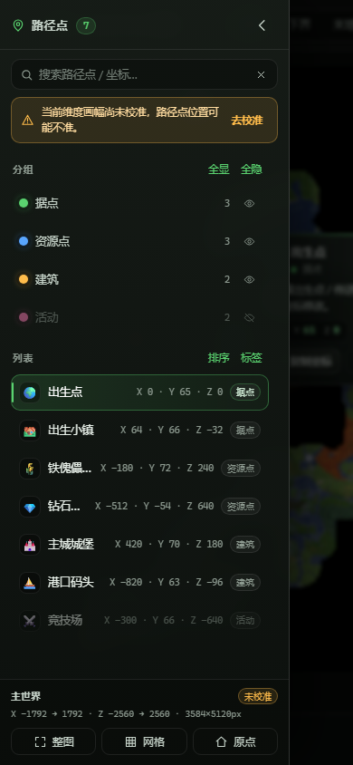

# Steve Server 地图

Minecraft 服务器的**离线地图站点**：一张导出的地图 PNG + 一份 `config.json`，就能得到一个可以拖动缩放、按维度切换、带分组和搜索的网页地图。

纯静态、零依赖、零构建：没有 npm、没有 CDN、不联网，把整个目录丢到 GitHub Pages、对象存储或内网 IIS/nginx 上就能用。

**线上地址：<https://steveservermap.github.io/>**（部署在 GitHub Pages，`main` 分支根目录，详见 [第 8 节](#8-部署到-github-pages)）

- 🗺️ **多维度**：主世界 / 下界 / 末地各一张基底图，一键切换
- 📍 **路径点由配置驱动**：加一个点 = 在 `config.json` 里加几行
- 🎯 **画幅变了也不丢点**：路径点存的是**世界坐标**，重新导出地图后重新校准一次，所有点自动对回（本项目的核心设计）
- 🔍 分组显隐、搜索、标签模式、坐标网格、比例尺、坐标读数、链接分享
- 🌙 深色 Minecraft 风格界面，手机 / 平板可用（侧栏变抽屉）
- 🧭 内置**校准向导**：地图上点两个已知地标，自动反解画幅并生成可粘贴的 JSON

---

## 界面预览

线上实况（<https://steveservermap.github.io/>，点路径点后的详情卡片）：



| 桌面端（主世界 + 路径点菜单） | 校准向导 |
| --- | --- |
|  |  |

| 拾取地标（校准中，面板会自动让路） | 手机端（侧栏变抽屉） |
| --- | --- |
|  |  |

> 截图来自真实浏览器（Edge headless），基底图为仓库内的 `主世界.png`，路径点是 `config.json` 里的示例数据。

---

## 目录

- [1. 快速开始](#1-快速开始)
- [2. 目录结构](#2-目录结构)
- [3. 核心概念：为什么换了地图路径点也不会丢](#3-核心概念为什么换了地图路径点也不会丢)
- [4. config.json 字段说明](#4-configjson-字段说明)
- [5. 常见配置操作](#5-常见配置操作)
- [6. 画幅变了：重新校准](#6-画幅变了重新校准)
- [7. 替换基底地图](#7-替换基底地图)
- [8. 部署到 GitHub Pages](#8-部署到-github-pages)
- [9. 常用操作与小技巧](#9-常用操作与小技巧)
- [10. 常见问题](#10-常见问题)
- [11. 浏览器支持](#11-浏览器支持)

---

## 1. 快速开始

### 本地预览（推荐）

在项目目录里启动一个静态服务器：

```bash
# 需要 Python 3
python -m http.server 8000
```

然后浏览器打开：

```
http://localhost:8000/
```

Windows 用户也可以直接双击仓库里的 **`serve.cmd`**（等价于上面的命令，会自动切换到脚本所在目录）。

> ⚠️ **不要直接双击 `index.html` 用 `file://` 打开。**
> 页面用 `fetch()` 读取 `config.json`，而浏览器的同源策略会拦截 `file://` 下的本地文件请求，结果就是地图区一直显示「无法加载 config.json」。必须通过 `http://` 访问。
> 同理，用 VS Code 的 Live Server、`npx serve`、nginx 都可以，只要能从 http 访问到 `config.json` 和 PNG。

### 换成你自己的数据

1. 把导出的地图覆盖到 `主世界.png`（或改 `config.json` 里的 `image` 字段，见 [第 7 节](#7-替换基底地图)）；
2. 打开页面 → 点顶栏「校准」，按 [第 6 节](#6-画幅变了重新校准) 校准一次；
3. 编辑 `config.json`，把你的路径点、分组填进去；
4. 刷新页面，完成。

---

## 2. 目录结构

```
SteveServerMap.github.io/
├── index.html                 页面骨架（唯一入口）
├── config.json                ★ 你要编辑的配置文件：维度 / 画幅 / 分组 / 路径点
├── config.schema.json         配置的 JSON Schema（供编辑器补全与校验）
├── 主世界.png                 基底地图（主世界）
├── 下界.png                   基底地图（下界，当前是占位图）
├── 末地.png                   基底地图（末地，当前是占位图）
├── serve.cmd                  Windows 一键本地预览
├── docs/
│   ├── CONTRACT.md            内部接口契约（开发者用，使用者可以跳过）
│   ├── QA.md                  自动化验收说明与最近结果（开发者用）
│   └── screenshots/           界面截图（README 里引用）
├── assets/
│   ├── css/
│   │   └── style.css          全部样式（颜色变量都集中在 :root，方便换肤）
│   └── js/
│       ├── config.js          读取 + 规范化 config.json
│       ├── coords.js          世界坐标 ↔ 图片像素（纯函数）
│       ├── viewer.js          地图平移 / 缩放引擎
│       ├── markers.js         路径点标记与详情卡片
│       ├── sidebar.js         左侧菜单（分组 / 列表 / 搜索）
│       ├── calibrate.js       校准向导
│       └── app.js             装配层（把上面这些接起来）
└── tests/                     自动化验收脚本（开发者用）
```

日常只需要动两个东西：**`config.json`** 和 **三张 PNG**。其他文件不用改。

---

## 3. 核心概念：为什么换了地图路径点也不会丢

很多人做离线地图的方式是「把路径点的坐标记成图片上的像素位置」。这样一旦重新导出地图（裁剪范围变了、分辨率变了、换了渲染器），所有点立刻全部错位，只能一个个重新摆。

这个项目不这么干：

```
路径点  ──世界坐标(x, z)──►  换算（靠 calibration）  ──►  图片像素(px, py)  ──►  屏幕位置
                                     ▲
                                     └── 换了地图，只改这里
```

- **路径点只存 Minecraft 世界坐标**（比如出生点就是 `x: 0, z: 0`），跟图片完全无关；
- **配置里额外存一份「画幅校准参数」**：图片左/右边缘对应世界的哪个 X、上/下边缘对应世界的哪个 Z；
- 页面每次都实时用这组参数把世界坐标换算成像素位置。

所以重新导出一张画幅不同的地图时：

1. 覆盖 PNG；
2. 用校准向导重新解一次画幅（两个已知地标就够）；
3. 所有路径点**自动**回到正确位置 —— 一个点都不用改。

换算公式（`W/H` 是图片原始像素宽高，`px/py` 以图片左上角为原点）：

```
px = (x - xMin) / (xMax - xMin) * W
py = (z - zMin) / (zMax - zMin) * H        // 开了南北翻转 flipZ 时取 1 - t
```

---

## 4. config.json 字段说明

配置文件是普通 JSON，用 UTF-8 保存。JSON 不允许注释，也不允许结尾多余逗号（这是最常见的报错原因）。

### 4.1 顶层

| 字段 | 类型 | 默认 | 说明 |
| --- | --- | --- | --- |
| `version` | number | `1` | 配置格式版本，当前固定 `1` |
| `site` | object | — | 站点文字，见下表 |
| `defaultDimension` | string | 第一个维度 | 打开页面时默认显示的维度 `id` |
| `ui` | object | — | 界面选项，见下表 |
| `dimensions` | array | **必填** | 维度列表，至少一个 |

`site`：

| 字段 | 说明 |
| --- | --- |
| `title` | 顶栏标题（也用作浏览器标签页标题） |
| `subtitle` | 顶栏副标题（窄屏自动隐藏） |
| `footer` | 页脚文字 |

`ui`：

| 字段 | 类型 | 默认 | 说明 |
| --- | --- | --- | --- |
| `labelMode` | `"always"` / `"hover"` / `"never"` | `"hover"` | 路径点名称标签的显示方式；页面内可按 `L` 循环切换 |
| `grid` | boolean | `false` | 初始是否显示坐标网格；页面内可按 `G` 切换 |
| `startCollapsed` | boolean | `false` | 初始是否收起左侧菜单（窄屏默认收起） |
| `showCoords` | boolean | `true` | 是否在地图左下角显示鼠标处的坐标读数 |

### 4.2 维度（`dimensions` 数组元素）

| 字段 | 类型 | 必填 | 说明 |
| --- | --- | --- | --- |
| `id` | string | ✅ | 维度标识，用于 URL 与内部引用，如 `overworld` / `nether` / `the_end` |
| `name` | string | ✅ | 显示名称，如 `主世界` |
| `image` | string | ✅ | 基底图片路径，**相对站点根目录**，如 `主世界.png` |
| `calibration` | object | — | 画幅校准参数，见 4.3；缺失时路径点无法定位，界面会提示「未校准」 |
| `groups` | array | — | 分组，见 4.4 |
| `waypoints` | array | — | 路径点，见 4.5 |

### 4.3 校准参数 `calibration`

推荐写法（校准向导输出的就是它）：

| 字段 | 类型 | 说明 |
| --- | --- | --- |
| `calibrated` | boolean | 是否已经确认校准过。`false` 时侧栏会显示「当前维度画幅尚未校准」的提示 |
| `xMin` | number | **图片左边缘**对应的世界 X |
| `xMax` | number | **图片右边缘**对应的世界 X |
| `zMin` | number | **图片上边缘**对应的世界 Z |
| `zMax` | number | **图片下边缘**对应的世界 Z |
| `flipZ` | boolean | 南北翻转：图片**上方是 +Z** 时置 `true`（默认 `false`，即上方是 `-Z`） |
| `note` | string | 备注，只用于说明，可以随便写 |

替代写法（已知「每方块多少像素」时更方便，二选一，`xMin` 优先）：

| 字段 | 类型 | 说明 |
| --- | --- | --- |
| `pixelsPerBlock` | number | 每方块像素数，如 `1` 表示 1 像素 = 1 方块 |
| `originX` | number | **图片左上角**对应的世界 X |
| `originZ` | number | **图片左上角**对应的世界 Z |

> `xMin/xMax/zMin/zMax` 必须严格递增（`xMax > xMin`、`zMax > zMin`）；方向由哪张图决定，填反了路径点会整体镜像。

### 4.4 分组 `groups`

| 字段 | 类型 | 必填 | 说明 |
| --- | --- | --- | --- |
| `id` | string | ✅ | 分组标识，路径点的 `group` 引用它 |
| `name` | string | ✅ | 显示名称 |
| `color` | string | — | 分组颜色（十六进制），如 `#5ad26f`；缺省灰色 |
| `visible` | boolean | — | 初始是否显示，默认 `true` |

### 4.5 路径点 `waypoints`

| 字段 | 类型 | 必填 | 说明 |
| --- | --- | --- | --- |
| `id` | string | ✅ | 唯一标识，用于 URL 深链 `#wp=spawn`（填 **id**，不是显示名称） |
| `name` | string | ✅ | 显示名称 |
| `x` | number | ✅ | 世界 X 坐标（方块） |
| `z` | number | ✅ | 世界 Z 坐标（方块） |
| `y` | number | — | 世界 Y 坐标，仅用于显示（如 `65`） |
| `group` | string | — | 所属分组 `id`，缺省归入「未分组」 |
| `icon` | string | — | 图标 key 或直接写 emoji，缺省 `pin`，见下表 |
| `color` | string | — | 覆盖分组色 |
| `label` | `"always"` / `"hover"` / `"never"` | — | 该点标签策略，缺省跟随 `ui.labelMode` |
| `description` | string | — | 详情卡片里的描述 |
| `url` | string | — | 详情卡片里的外链（如截图、攻略） |

可用图标 key（也可以直接写一两个字符的 emoji）：

| key | 图标 | key | 图标 | key | 图标 |
| --- | --- | --- | --- | --- | --- |
| `pin` | 🧷 | `home` | 🏠 | `village` | 🏘️ |
| `farm` | 🌾 | `mine` | ⛏️ | `portal` | 🌀 |
| `chest` | 📦 | `diamond` | 💎 | `skull` | ☠️ |
| `tower` | 🏰 | `ship` | ⛵ | `mountain` | ⛰️ |
| `redstone` | 🔴 | `nether` | 🐷 | `end` | 🐉 |
| `shop` | 🛒 | `spawn` | 🌍 | `bed` | 🛏️ |
| `pvp` | ⚔️ | `event` | 🎪 | `question` | ❓ |

### 4.6 一份完整的示例

```json
{
  "version": 1,
  "site": {
    "title": "Steve Server 地图",
    "subtitle": "离线地图 · 不定期更新",
    "footer": "路径点由 config.json 驱动 · 修改后刷新页面生效"
  },
  "defaultDimension": "overworld",
  "ui": { "labelMode": "hover", "grid": false, "startCollapsed": false, "showCoords": true },
  "dimensions": [
    {
      "id": "overworld",
      "name": "主世界",
      "image": "主世界.png",
      "calibration": {
        "calibrated": true,
        "xMin": -1792,
        "xMax": 1792,
        "zMin": -2560,
        "zMax": 2560,
        "flipZ": false,
        "note": "2025 年春季导出，3584×5120 像素，1 像素 = 1 方块"
      },
      "groups": [
        { "id": "base", "name": "据点", "color": "#5ad26f", "visible": true },
        { "id": "resource", "name": "资源点", "color": "#59a6ff", "visible": true }
      ],
      "waypoints": [
        {
          "id": "spawn",
          "name": "出生点",
          "x": 0,
          "y": 65,
          "z": 0,
          "group": "base",
          "icon": "spawn",
          "label": "always",
          "description": "服务器出生点 / 传送落点。"
        },
        {
          "id": "iron-farm",
          "name": "铁傀儡农场",
          "x": -180,
          "y": 72,
          "z": 240,
          "group": "resource",
          "icon": "farm",
          "description": "自动刷铁机，24 小时运行。",
          "url": "https://example.com/iron-farm"
        }
      ]
    },
    {
      "id": "nether",
      "name": "下界",
      "image": "下界.png",
      "calibration": {
        "calibrated": true,
        "xMin": -1024,
        "xMax": 1024,
        "zMin": -1024,
        "zMax": 1024,
        "flipZ": false,
        "note": "下界坐标通常只有主世界的 1/8"
      },
      "groups": [{ "id": "portal", "name": "传送门", "color": "#b485ff", "visible": true }],
      "waypoints": [
        {
          "id": "nether-hub",
          "name": "下界交通枢纽",
          "x": 40,
          "y": 70,
          "z": -52,
          "group": "portal",
          "icon": "portal",
          "description": "连接各基地的冰道枢纽。"
        }
      ]
    }
  ]
}
```

> 编辑时把 `config.schema.json` 关联上（VS Code 里在文件顶部加 `"$schema": "./config.schema.json",`），可以获得字段补全和错误提示。

---

## 5. 常见配置操作

### 5.1 加一个路径点

在对应维度的 `waypoints` 数组里追加一项即可（`id` 在同一维度内唯一）：

```json
{
  "id": "gold-farm-2",
  "name": "金农场二期",
  "x": 640,
  "y": 68,
  "z": -420,
  "group": "resource",
  "icon": "farm",
  "description": "新增的刷金机。"
}
```

保存 → 刷新页面。坐标从游戏里按 `F3` 抄（X / Y / Z 是三个数字，注意别把 Y 当成 Z）。

### 5.2 加一个分组

```json
{ "id": "pvp", "name": "PVP 场地", "color": "#ff7ab6", "visible": true }
```

然后给路径点写 `"group": "pvp"`。引用了不存在的分组时，该点会落到「未分组」并在控制台给出提示。

### 5.3 加一个维度

1. 把新地图图片放到站点根目录（如 `资源世界.png`）；
2. 在 `dimensions` 数组里加一项：

```json
{
  "id": "resource_world",
  "name": "资源世界",
  "image": "资源世界.png",
  "calibration": { "calibrated": false, "xMin": -2048, "xMax": 2048, "zMin": -2048, "zMax": 2048 },
  "groups": [{ "id": "ore", "name": "矿区", "color": "#ffbc4b", "visible": true }],
  "waypoints": []
}
```

3. 刷新后顶栏/侧栏会出现「资源世界」按钮；
4. 切换过去 → 点「校准」校准这张图的画幅（见下一节）。

### 5.4 改颜色 / 换肤

- 分组颜色：`groups[].color`，或单个点的 `waypoints[].color`；
- 界面主题色：`assets/css/style.css` 顶部 `:root` 里的 `--accent`（默认草绿 `#5ad26f`）、`--bg`、`--panel` 等变量，改一处全站生效。

---

## 6. 画幅变了：重新校准

**什么时候需要校准？** 只要「同一块世界在图片上占的像素位置」变了，就要重新校准：

- 重新导出了地图（换了渲染器、改了渲染范围、改了缩放倍率/分辨率）；
- 裁剪了图片（裁掉白边、只留主城）；
- 换了图片尺寸（大图压小图）。

**操作步骤：**

1. 点顶栏的「校准」按钮（或侧栏黄色提示条里的「去校准」），打开校准向导。
2. 确认页签在「**两点校准**」。
3. 点「**拾取 A**」，然后在地图上单击一个**你知道精确世界坐标**的地标（出生点、传送门、主城中心、某个方块的角都可以）。拾取后填它的 X / Z：
   - 用游戏内坐标最好；如果只知道大概位置，就点那个位置对应的方块中心，误差会直接反映到校准结果里。
4. 点「**拾取 B**」，同样在地图上点第二个地标并填坐标。
   - 两个地标要**尽量拉开距离**，并且**不能在几乎同一行或同一列**上（否则有一个方向解不出来，向导会用红色提示）。
5. 向导会实时显示解出的画幅和状态：

   ```
   画幅已解出
   图片 3584 × 5120 px
   X：-1792 → 1792   每方块 1 px（1 px ≈ 1 方块）
   Z：-2560 → 2560   每方块 1 px（1 px ≈ 1 方块）
   ```

   - 如果两个方向的「每方块像素数」差得很多，向导会提示可能是地标坐标填错了（或者图片被非等比拉伸过）；
   - 如果图片是「南在上」（上方是 +Z），向导会自动识别并置 `flipZ: true`，也可以在「直接输入画幅」页签里手动勾「南北翻转」。
6. 点「**复制 JSON 片段**」，得到类似这样的内容：

   ```json
   {
     "calibrated": true,
     "xMin": -1792,
     "xMax": 1792,
     "zMin": -2560,
     "zMax": 2560,
     "flipZ": false,
     "note": "两点校准 · 图片 3584×5120px · 每方块 1px · 由校准向导生成"
   }
   ```

7. 打开 `config.json`，把它**整体替换**掉对应维度的 `calibration` 字段（`calibrated` 已经是 `true`，不用再改），保存。
8. 刷新页面 —— 所有路径点都会落在正确位置。

> **只想先自己看看效果？** 点「应用并刷新」可以立即在**当前浏览器**预览（存在浏览器 localStorage 里，不会写进 `config.json`）。页脚会出现「本地校准生效（仅本浏览器）· 点击清除」，点它即可还原。要让**所有访客**都看到新校准，仍然必须按上面第 6~8 步写进 `config.json`。

**「直接输入画幅」页签**适合你已经知道边界值的情况（比如渲染器直接告诉了你地图覆盖 `-2048..2048` 的世界范围）：填四个边界 + 勾选是否翻转即可，同样实时预览、实时校验，「应用并刷新」与「复制 JSON」的行为一致。

**「恢复默认」**会把输入还原成 `config.json` 里当前维度的画幅，方便改坏了回退。

> 💡 为什么两点就够了？
> 世界坐标到图片像素是**线性**关系，每个方向只有一个尺度、一个偏移，两个未知数；一条轴上两个已知点就能解出来。`px = (x - xMin) / (xMax - xMin) * W` 反解即可，所以两点 × 两个方向（横、纵）= 四个边界值全部确定。

---

## 7. 替换基底地图

三张基底图固定放在站点根目录：

| 维度 | 默认文件名 | 当前状态 |
| --- | --- | --- |
| 主世界 | `主世界.png` | 已放置（3584×5120） |
| 下界 | `下界.png` | **占位图**，请替换成真实导出图 |
| 末地 | `末地.png` | **占位图**，请替换成真实导出图 |

两种换法，任选其一：

1. **保持文件名**（最省事）：直接把新图覆盖同名文件，`config.json` 不动。换完记得重新校准。
2. **改配置**：把新图放进来（如 `overworld-2025.png`），然后把对应维度的 `"image"` 改成新文件名。

注意事项：

- `image` 是**相对站点根目录**的路径；放在子目录里也可以写成 `"maps/overworld.png"`。
- **文件名大小写敏感**（GitHub Pages 是 Linux）：`Overworld.PNG` ≠ `overworld.png`。
- 中文文件名可用，但少数旧浏览器/工具链对 URL 编码处理不好；追求稳妥可以改成英文名（`overworld.png` / `nether.png` / `end.png`）。
- 换图后**一定要重新校准**（第 6 节）：图片换了，画幅几乎必然变化。
- 大图建议：单边长不超过约 8000 px、文件控制在 10 MB 以内，否则手机端加载会慢。PNG 可以用 `pngquant` / `oxipng` 压缩；如果地图是纯色块风格，压完往往能小一半以上。
- 地图渲染工具随意：Chunky、Minecraft Overviewer、unmined 等导出的俯视图都可以，只要是一张**正上方俯视、无透视变形**的图片。

---

## 8. 部署到 GitHub Pages

推荐直接用「用户名.github.io」仓库，地址最干净。

1. 新建仓库：`<你的GitHub用户名>.github.io`（**必须**是这个名字才能用根域名访问）。
2. 把整个项目目录推送上去（`index.html`、`config.json`、三张 PNG、`assets/` 等都在**仓库根目录**，不要多套一层文件夹）：

   ```bash
   git init
   git add -A
   git commit -m "update map"
   git branch -M main
   git remote add origin https://github.com/<你的用户名>/<你的用户名>.github.io.git
   git push -u origin main
   ```

3. 打开仓库 → **Settings** → 左侧 **Pages** → *Source* 选 **Deploy from a branch** → Branch 选 `main`、目录选 `/ (root)` → **Save**。
4. 等 1~2 分钟，访问 `https://<你的用户名>.github.io/`。

其他要点：

- 也可以用普通仓库 + 子路径部署（`https://<用户名>.github.io/<仓库名>/`），此时所有路径都是相对的，无需改代码。
- 仓库是公开的才能免费用 Pages；私有仓库需要付费方案。
- 自定义域名：在 Pages 设置里填域名，再按提示配置 DNS 的 `CNAME`。
- **更新后看不到变化？** 先 `Ctrl + F5`（强制刷新）。GitHub Pages 有 CDN 缓存，PNG 同名覆盖后可能几分钟才更新；想立刻生效可以给图片改个名并同步改 `config.json` 的 `image`。
- 部署后如果只有地图不显示：打开开发者工具 → Network，看 PNG 是否 404（多半是文件名大小写或路径不对）。

---

## 9. 常用操作与小技巧

| 操作 | 说明 |
| --- | --- |
| 拖拽 / 单指拖动 | 平移地图 |
| 滚轮 / 双指捏合 / `+` `-` | 缩放（以鼠标位置为锚点） |
| 方向键 | 平移（先点一下地图让它获得焦点） |
| 双击路径点 / 点击列表项 | 居中到该点并弹出详情 |
| 顶栏「分享」 | 把当前维度 + 中心坐标 + 缩放级别写进 URL 并复制，别人打开就是同一个视角 |
| `G` | 显示/隐藏坐标网格 |
| `L` | 循环切换标签模式（悬停 / 常显 / 隐藏） |
| `Esc` | 关闭详情卡片 / 取消拾取 / 关闭校准向导 |
| 搜索框 | 支持名称、描述、坐标（如 `-512 640`） |
| 分组「眼睛」按钮 | 单独显示/隐藏某组；面板上的「全显 / 全隐」批量操作 |
| 「整图」 | 缩放到整张地图刚好铺满 |
| 「原点」 | 回到世界 `(0, 0)` |

URL 深链格式（可以手动拼，也可以从「分享」按钮拿）：

```
https://你的站点/#dim=overworld&x=120&z=-340&s=0.75&wp=spawn
```

---

## 10. 常见问题

**Q：双击 `index.html` 打开是一片空白 / 一直「无法加载 config.json」。**
浏览器的本地文件策略不允许 `file://` 页面用 `fetch` 读取同目录文件。请按 [第 1 节](#1-快速开始) 用 `python -m http.server 8000` 通过 `http://localhost:8000/` 访问。

**Q：地图区提示「地图还没上传」/ 图片 404。**
按顺序检查：① 文件名和 `config.json` 里的 `image` 是否**完全一致**（含扩展名、大小写）；② 图片是否在站点根目录（或 `image` 里写的相对路径是否正确）；③ 浏览器开发者工具 Network 面板看该图片请求是不是 404；④ 图片本身有没有损坏（能双击打开吗）。

**Q：路径点整体偏移 / 全部跑到一起了。**
先看侧栏是否有「当前维度画幅尚未校准」的提示 —— `calibrated: false` 或者 `calibration` 四个边界还是默认值，就会整体偏。按 [第 6 节](#6-画幅变了重新校准) 用两个地标校准一次即可。如果校准后仍然偏：检查两个地标的坐标是否填错（最容易发生）、两点是否离得太近；如果地图图片被非等比拉伸过，X/Z 比例会不一致，向导会给出提示。

**Q：南北颠倒（上下反了）。**
图片上方是 `+Z` 时，把 `calibration.flipZ` 设为 `true`。用两点校准时向导会自动判断；手动输入时勾「南北翻转（图片上方是 +Z）」。

**Q：左右镜像（东西反了）。**
`xMin` 必须是图片**左边缘**的世界 X。不要把它和 `xMax` 填反，也不要抄错两个地标的 X。本项目没有 `flipX`：地图应当是从正上方俯视、东在右的正常朝向。

**Q：路径点互相重叠，点不到下面那个。**
放大即可分离；也可以打开标签模式（`L`）或按分组筛选。两个点在世界上本来就挨得很近时，视觉重叠是正常的 —— 点击命中的是最上层（通常是最后渲染的那个），建议把重要地点稍微错开或拆到不同分组。

**Q：改了 `config.json` 刷新不生效。**
① 浏览器缓存 → `Ctrl + F5`；② JSON 语法错误 → 按 `F12` 看 Console，页面会直接提示「config.json 不是合法的 JSON」；最常见原因是**结尾多余的逗号**、**中文引号 `“”`**、**注释**（JSON 不支持注释）。建议用支持 JSON Schema 的编辑器打开。

**Q：校准后只有我这台电脑是对的，别人打开还是歪的。**
「应用并刷新」只写进当前浏览器的 localStorage。要把校准结果固化，必须点「复制 JSON 片段」→ 粘进 `config.json` 的 `calibration` → 保存并部署。页脚出现「本地校准生效（仅本浏览器）· 点击清除」时，说明你现在看到的是本地覆盖，点它即可清除。

**Q：下界 / 末地地图是空白的。**
仓库里的 `下界.png`、`末地.png` 目前是占位图。换成真实导出图，然后重新校准该维度即可。

**Q：手机上侧栏挡住地图 / 打不开侧栏。**
窄屏（≤ 860 px）下侧栏变成覆盖式抽屉：点左上角菜单按钮开合，点遮罩关闭。地图本身不受影响。

**Q：搜索不到路径点。**
搜索匹配名称、描述和坐标文本。若该点所在分组被隐藏，地图上不显示但列表仍可搜到；如果是坐标搜索，试试写成 `X Z` 两段（如 `-512 640`）。

---

## 11. 浏览器支持

需要支持 ES Module（`<script type="module">`）、CSS `backdrop-filter` 和 `dvh` 单位的现代浏览器：

- ✅ Chrome / Edge 108+
- ✅ Safari 16+（macOS / iOS）
- ✅ Firefox 110+
- ❌ 不支持 Internet Explorer

页面完全离线：没有 CDN、没有外部字体、没有网络请求（除了本身的 `config.json` 和 PNG）。字体使用系统字体（`-apple-system` / `Segoe UI` / `Microsoft YaHei`），坐标用系统等宽字体显示。

---

## 附：给开发者

接口契约、模块职责、验收标准在 [`docs/CONTRACT.md`](docs/CONTRACT.md) 里；自动化验收的检查项、最近结果与已知限制在 [`docs/QA.md`](docs/QA.md) 里。改样式只需要动 `assets/css/style.css`（颜色变量集中在 `:root`），改逻辑按模块各改各的，`app.js` 里所有跨模块调用都做了存在性检查，缺方法只会警告不会整页崩溃。

```bash
# 纯函数单测（不需要浏览器，最快）
node --test tests/coords.test.mjs

# 静态检查：文件/引用/config/import/CSS 契约（不需要浏览器）
node tests/static-checks.mjs

# 端到端验收：自起静态服务器 + 无头 Edge，约 22s，退出码 0/1
node tests/smoke.mjs
node tests/smoke.mjs --url=http://127.0.0.1:8000/index.html   # 也可指向已启动的服务
```

> 两个 smoke 实例不能同时跑（共用 `tests/artifacts/`，内置 pid 锁会拒绝第二次启动）。
> 测试只依赖本机已安装的 Edge / Chrome，无需 `npm install`。
